<p align="center">
<picture>
  <source media="(prefers-color-scheme: dark)" srcset="assets/banner-dark.svg">
  
</picture>
</p>

<p align="center">
  <a href="https://www.linkedin.com/in/ayushwadje">LinkedIn</a> &nbsp;|&nbsp;
  <a href="mailto:ayushwadje@gmail.com">ayushwadje@gmail.com</a>
</p>

<h3>
<picture>
  <source media="(prefers-color-scheme: dark)" srcset="assets/h-work-dark.svg">
  
</picture>
</h3>

**Aerolung**
A lung stress index for asthma and COPD risk. It combines live air quality (PM2.5, O3, NO2) with the user's own SpO2 and breathing rate, and a TensorFlow/Keras model rates flare-up risk from Low to Extreme. The backend is FastAPI with JWT auth and a SQLite exposure timeline, and the Expo app shows animated lungs and a live AQI heatmap.
`FastAPI` `TensorFlow/Keras` `React Native` `SQLite`

**Smart insole gait analysis** (research, ongoing)
A wearable insole that classifies how someone walks, in real time. FSR402 pressure sensors and an MPU-6050 IMU feed TinyML inference running on a Seeed XIAO nRF52840, and the result streams over BLE to a Flutter app.
`Embedded C++` `TinyML` `BLE` `Flutter`

**Secure Shared Storage**
A three-VM lab with OpenLDAP for identity and MIT Kerberos for ticket-based single sign-on (realm LAB.LOCAL), serving NFSv4 exports secured with `sec=krb5`. What went wrong along the way is written up below.
`Linux` `OpenLDAP` `Kerberos` `NFSv4` `VirtualBox`

**ToxPredict-Transformer**
A transformer that predicts chemical compound toxicity by running self-attention over molecular features. Preprocessing, tokenization, training and evaluation are modular and reproducible. It is scored with ROC-AUC and precision-recall, because accuracy on imbalanced data can look fine while toxic compounds slip through.
`Python` `PyTorch` `Transformers` `Scikit-learn`

<h3>
<picture>
  <source media="(prefers-color-scheme: dark)" srcset="assets/h-chain-dark.svg">
  
</picture>
</h3>

The insole and Aerolung have the same shape: read a signal, run a model, send the result, show it.

<p align="center">
<picture>
  <source media="(prefers-color-scheme: dark)" srcset="assets/chain-dark.svg">
  
</picture>
</p>

<h3>
<picture>
  <source media="(prefers-color-scheme: dark)" srcset="assets/h-bug-dark.svg">
  
</picture>
</h3>

```text
found   VM clock drift of 42 hours, which broke ticket validation
found   FQDN service principal missing from the keytab
found   misconfigured krb5.conf on the NFS server
used    kvno, klist, journalctl
result  authenticated NFSv4 storage shared across the VMs
```

<h3>
<picture>
  <source media="(prefers-color-scheme: dark)" srcset="assets/h-tools-dark.svg">
  
</picture>
</h3>

- **Languages:** Python, Java, Kotlin, C++ (Arduino and embedded), JavaScript, SQL
- **Backend and cloud:** FastAPI, Flask, REST, JWT, Docker, Google Cloud Run, AWS, CI/CD
- **Linux and security:** Linux administration, OpenLDAP, MIT Kerberos, NFSv4
- **Machine learning:** PyTorch, TensorFlow/Keras, Scikit-learn, Transformers, TinyML
- **IoT and embedded:** ESP32, Raspberry Pi, nRF52840, MQTT, BLE
- **Mobile:** React Native (Expo), Flutter, Android SDK, Firebase
- **Data and tools:** MySQL, SQLite, Git, GitHub, VS Code

<h3>
<picture>
  <source media="(prefers-color-scheme: dark)" srcset="assets/h-more-dark.svg">
  
</picture>
</h3>

- Won **HackNexus 2.0** with Team Copy-Paste, a five-person team that fixed last-minute bugs and shipped a working build before the deadline.
- Deployed a containerized AI agent to Google Cloud Run with Docker, my first production deployment.
- B.Tech in Internet of Things at Yeshwantrao Chavan College of Engineering, Nagpur (2024 to 2027). Diploma in Computer Engineering (2020 to 2023).
- Certificates: Database Structures and Management with MySQL (Meta, Coursera, Nov 2025). Complete UNIX & Linux OS Fundamentals Training (Infosys Springboard, Nov 2025).

<br>

<p align="center">
  Hiring for an entry-level software role? Write to <a href="mailto:ayushwadje@gmail.com">ayushwadje@gmail.com</a> or message me on <a href="https://www.linkedin.com/in/ayushwadje">LinkedIn</a>.
</p>
